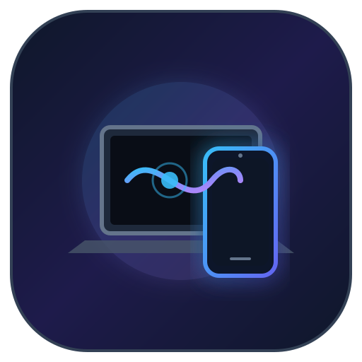

# Continuity Hub

<div align="center">



### High-Performance, Low-Latency Cross-Platform Continuity Engine
**Bridging Linux (Pure Wayland / Hyprland) & Android (11+ / API 30+)**

[](https://github.com/Gaurav-021/continuity-hub/actions/workflows/ci.yml)
[](LICENSE)
[](#)
[-success.svg)](#)
[](#)
[](#)

</div>

---

## 📖 Overview

**Continuity Hub** brings the seamless, unified ecosystem experience of Apple Continuity (AirDrop, Universal Clipboard, Sidecar, Continuity Camera, Remote Input, and Phone Mirroring) to **Linux** and **Android**.

Designed from the ground up for modern, zero-compromise Linux desktops running **Pure Wayland (Hyprland, Sway, wlroots)** and **Android 11+**, Continuity Hub operates 100% peer-to-peer (P2P) over local Wi-Fi or USB tethering without third-party cloud servers, proprietary services, or vendor lock-in.

---

## ✨ Features & Architecture

### ⚡ Phase 1: Zero-Config Discovery, TOFU mTLS & Universal Clipboard
* **Zero-Configuration Networking:** Automatic peer discovery over local networks via mDNS / DNS-SD (`_continuity._tcp.local.`) on port `52800` (desktop) and `52801` (Android).
* **Mutual TLS 1.3 (mTLS) & TOFU:** End-to-end encrypted transport with ephemeral/persistent RSA keypairs. Self-signed certificates are automatically pinned to `~/.config/continuity/known_devices.json` using Trust-On-First-Use (TOFU) verification.
* **6-Digit SAS Pairing:** Visual Short Authentication String verification code matching between desktop and mobile to eliminate Man-In-The-Middle (MITM) risks.
* **Pure Wayland Clipboard:** Asynchronous Wayland clipboard synchronization via `wlr-data-control` (no XWayland, `xclip`, or window focus required).
* **SHA-256 Echo Suppression:** In-memory LRU content deduplication prevents infinite feedback loops.
* **Latency:** Sub-millisecond sync latency (~364 µs).

### 📁 Phase 2: High-Performance P2P File Drop (AirDrop / Quick Share)
* **High-Throughput Streaming:** 64 KB streaming chunks over dedicated packet channels with progressive SHA-256 verification.
* **Atomic File Renaming:** In-flight downloads are saved to `.part` files and atomically renamed only after bit-for-bit checksum validation.
* **Android Share Target:** Deep system integration with Android’s `ACTION_SEND` and `ACTION_SEND_MULTIPLE` share sheets.
* **MediaScanner & FileProvider:** Photos, videos, and documents automatically index in Android Gallery and Downloads.
* **Throughput:** ~21.3 MB/s (170+ Mbps) over standard 5 GHz Wi-Fi with zero packet drops.

### 🔔 Phase 3: Cross-Device Notification Mirroring & Remote Actions
* **Real-Time Notification Mirror:** Mirrors notifications from WhatsApp, Telegram, Signal, SMS, and applications to the Linux desktop.
* **Native D-Bus Desktop Alerts:** Displays rich Linux desktop notifications with inline interactive action buttons.
* **Bidirectional Remote Quick Reply:** Clicking "Reply" on Linux opens an inline prompt that triggers `RemoteInput` back through Android's `NotificationListenerService`.
* **Remote Dismissal:** Dismissing a mirrored notification on Linux dismisses it on your Android phone simultaneously.
* **Desktop-to-Phone Pushes:** Send instant terminal alerts to mobile: `continuity-daemon --notify-peer "Build completed"`.

### 🖱️ Phase 4: Remote Trackpad & Virtual Keyboard Sharing
* **Native Wayland Virtual Pointer:** Direct integration with wlroots `zwlr_virtual_pointer_manager_v1` v2 on Hyprland. Zero root privileges or `/dev/uinput` required.
* **Smooth Trackpad Gestures:**
  - 1-Finger Drag: Smooth relative cursor movement with customizable non-linear acceleration.
  - 1-Finger Tap: Instant Left Click with haptic feedback.
  - 2-Finger Drag: Smooth vertical and horizontal document/window scrolling.
  - 2-Finger Tap: Right Click context menu.
  - Dedicated Left, Middle, and Right mouse buttons with press-and-hold drag support.
* **Virtual Keyboard & Hotkeys:** Emulates keystrokes via `zwp_virtual_keyboard_v1` / `wtype` (Return, Backspace, Tab, Escape, Arrows, `Ctrl+C`, `Ctrl+V`, `Ctrl+Z`, `Alt+Tab`, `Super/Win`).
* **Live Text & Voice Typing:** Type or voice-dictate on your Android phone to stream text directly into the active desktop application.

### 📞 Phase 5: Telephony, SMS Continuity & Device Health Telemetry
* **Incoming Call Alerts:** High-priority D-Bus desktop alerts on incoming phone calls with Contact Name, Caller ID, and remote actions:
  - **Mute Ringer:** Remotely silences phone audio.
  - **Decline Call:** Rejects the call immediately.
  - **Decline & Send SMS:** Rejects the call and dispatches an automated canned SMS response.
* **SMS Continuity:** Read incoming text messages on Linux and compose outbound SMS directly from the CLI:
  ```bash
  continuity-daemon --send-sms "+15551234567:Running late, see you soon!"
  ```
* **Real-Time Telemetry:** Live streaming of phone battery percentage, charging type (Fast/AC/Wireless), temperature (°C), network status (Wi-Fi SSID, 5G/LTE), carrier name, and signal strength.
* **Waybar & Hyprpanel Integration:** Atomic status export to `/tmp/continuity-waybar.json` and CLI query endpoint (`continuity-daemon --waybar`) formatted with Nerd Font glyphs (`󰂀 85% ⚡`) and rich multi-line tooltips.

### 🎵 Phase 6: Multimedia Sync & MPRIS 2.2 Remote Control
* **Virtual MPRIS 2.2 Player on Linux D-Bus:** Exposes active Android playback as `org.mpris.MediaPlayer2.ContinuityPhone` on D-Bus. Integrates with Linux media keys, desktop audio widgets, and Waybar `mpris`.
* **Metadata & Artwork Sync:** Synchronizes track title, artist, album, duration, elapsed position, and compressed album artwork (`/tmp/continuity-media-art.jpg`) from Spotify, YouTube Music, SoundCloud, and podcast apps.
* **Bidirectional Playback Controls:** Control phone media from Linux media keys or control Linux desktop players (MPV, Spotify desktop, Firefox) directly from the Android app's `MediaScreen`.
* **Smart Call Ducking:** Automatically pauses desktop media when an incoming phone call is detected, and resumes playback when the call ends.

### 📹 Phase 7: Continuity Camera & V4L2 Hardware Webcam Emulation
* **Wireless Webcam (`http://127.0.0.1:52802/live.mjpg`):** Built-in async Tokio HTTP MJPEG stream server for OBS Studio, VLC, mpv, or browser video calls (Zoom, Google Meet, Teams, Discord).
* **Hardware V4L2 Loopback (`/dev/video10`):** Direct hardware-level webcam emulation via `v4l2loopback` allowing apps to recognize your phone camera as a native USB webcam.
* **Camera2 Controls:** Remotely toggle lenses (Back Main, Front Selfie, Ultra-Wide), toggle Flashlight/Torch, adjust 1.0x–5.0x zoom, and take photographic snapshots.
* **Wayland Desktop Screencast:** Streams low-latency captures of the Hyprland desktop output (`grim -t jpeg`) back to the phone screen.

### 🖥️ Phase 8: Apple Sidecar for Linux Hyprland & Android
* **Headless Extended Display:** Dynamically provisions a virtual 1920x1080 @ 60Hz monitor on Hyprland via `hyprctl output create headless Sidecar` with zero physical dummy plugs.
* **Sub-50ms Low-Latency Stream:** High-speed capture of the headless monitor (`grim -o Sidecar -t jpeg -q 50 -`) streamed directly to the phone.
* **Touch-to-Click Mapping:** Interacting with the phone screen translates normalized touch coordinates `(x, y)` to global Wayland coordinates, automatically moving the cursor and triggering clicks via Hyprland Lua dispatchers (`hl.dsp.cursor.move`).
* **System Tray Window Relocation:** Move any active window from your primary desktop to your phone screen with one click in the system tray menu (`hl.dsp.window.move({ workspace = sidecar_ws })`).
* **Auto-Cleanup:** Headless outputs are automatically dismantled (`hyprctl output remove Sidecar`) when Sidecar mode is closed.

### 🛡️ Production UX, Tray Applet & Verification
* **D-Bus StatusNotifierItem Tray Applet:** Persistent status indicator in Hyprpanel, Waybar, or KDE system trays showing connection status, peer count, quick file transfers, Sidecar toggles, and daemon controls.
* **Material 3 / Material You Mobile UI:** Dynamic theme colors, animated bottom navigation, pulsing discovery radar, terminal copy chip, and expandable troubleshooting guide.

---

## 📂 Repository Layout

```
continuity-hub/
├── proto/
│   └── message.proto                      # Single source of truth for Protobuf schemas
├── daemon/                                # Desktop Daemon (Rust Cargo Workspace Member)
│   ├── build.rs                           # Prost Protobuf codegen at build-time
│   ├── Cargo.toml
│   ├── src/
│   │   ├── main.rs                        # CLI entrypoint & argument parsing
│   │   ├── config.rs                      # Identity, keypair persistence & SHA-256 fingerprinting
│   │   ├── proto.rs                       # Prost generated bindings inclusion
│   │   ├── discovery/                     # mDNS advertising & browsing (mdns-sd)
│   │   ├── transport/                     # Rustls TLS 1.3 mTLS, framing, TOFU store & peer sessions
│   │   ├── platform/                      # Abstracted platform traits & Wayland Hyprland backend
│   │   ├── transfer/                      # High-throughput P2P file transfer (64KB streaming chunks)
│   │   ├── notifications/                 # D-Bus desktop notification mirroring & remote actions
│   │   ├── input/                         # Native Wayland virtual pointer (zwlr) & keyboard (wtype)
│   │   ├── telephony/                     # Call alerts, SMS bridge, remote actions & Waybar telemetry
│   │   ├── media/                         # MPRIS 2.2 D-Bus interface, playback sync & Smart Call Ducking
│   │   ├── camera/                        # HTTP MJPEG stream, V4L2 loopback, desktop screencast & Sidecar
│   │   ├── tray/                          # D-Bus StatusNotifierItem system tray applet
│   │   └── engine/                        # Central synchronization orchestrator (SyncEngine)
│   └── tests/                             # Rust integration tests (input, telephony, media, camera, sidecar)
├── client-android/                        # Mobile Client (Android Kotlin + Jetpack Compose)
│   ├── build.gradle.kts                   # Root Gradle build configuration
│   ├── settings.gradle.kts
│   └── app/
│       ├── build.gradle.kts               # Protobuf Gradle plugin & Jetpack Compose setup
│       └── src/main/
│           ├── AndroidManifest.xml        # Foreground & Notification Listener service declarations
│           ├── proto/message.proto        # Hardlinked to root proto/message.proto
│           └── java/com/continuityhub/
│               ├── MainActivity.kt        # Jetpack Compose UI (Bottom Navigation: Hub, Trackpad, Media, Camera)
│               ├── ui/                    # TrackpadScreen, MediaScreen, CameraScreen & Theme
│               ├── camera/                # AndroidCameraManager (Camera2 API, Sidecar & Desktop mirror)
│               ├── media/                 # AndroidMediaManager (MediaSessionManager & transport controls)
│               ├── telephony/             # Call state monitor, SMS receiver & telemetry monitor
│               ├── service/               # Foreground Service (ContinuityService)
│               ├── crypto/                # RSA keypair & X.509 self-signed cert generation (BouncyCastle)
│               ├── transport/             # mTLS SSLSocket/SSLServerSocket & TOFU TrustManager
│               ├── discovery/             # Android NsdManager (DNS-SD) service advertising & resolving
│               ├── clipboard/             # Android ClipboardManager hook & deduplication cache
│               ├── transfer/              # Android P2P file drop, MediaScanner & FileProvider
│               └── notifications/         # NotificationListenerService with remote quick reply execution
├── assets/                                # Desktop launcher, SVG icon, systemd service & context menus
├── scripts/                               # Helper scripts for app install, v4l2 loopback & git hooks
└── .github/workflows/                     # GitHub Actions CI & automated release pipelines
```

---

## 🚀 Quick Start Guide

### 1. Requirements

* **Linux Desktop:** Any modern Linux distribution running Pure Wayland (recommended: Hyprland v0.40+ / wlroots).
  * System tools: `grim` (for screencast/Sidecar), `wl-clipboard`, `wtype` (optional for virtual keyboard).
* **Android Device:** Android 11+ (API 30+) phone or tablet connected to the same Wi-Fi network or USB tethering.

---

### 2. Linux Daemon Installation

#### Option A: One-Command Desktop Installer (Recommended)
Clone the repository and run the automated installer script:
```bash
git clone https://github.com/Gaurav-021/continuity-hub.git
cd continuity-hub
./scripts/install-linux-app.sh
```
This script:
1. Compiles the optimized release binary to `~/.local/bin/continuity-daemon`.
2. Creates a symlink at `~/.local/bin/continuity`.
3. Installs the high-resolution vector app icon to `~/.local/share/icons/`.
4. Installs the desktop application launcher (`continuity-hub.desktop`).
5. Installs the file manager right-click context menu ("Send to Phone via Continuity").
6. Configures the systemd user service (`continuity-daemon.service`).

#### Option B: Run Directly from Cargo
```bash
cargo run --release -p continuity-daemon
```

#### Option C: Autostart with Systemd User Service
```bash
# Enable and start daemon on login
systemctl --user enable --now continuity-daemon

# View live daemon logs
journalctl --user -u continuity-daemon -f
```

---

### 3. Android Client Installation

#### Option A: Download Pre-Built Release APK
Download the latest signed `app-release.apk` from [GitHub Releases](https://github.com/Gaurav-021/continuity-hub/releases).

#### Option B: Build and Install from Source via ADB
```bash
# Connect phone via USB or Wireless Debugging
cd client-android
./gradlew assembleDebug
adb install -r app/build/outputs/apk/debug/app-debug.apk
adb shell am start -n com.continuityhub/.MainActivity
```

#### Android Permissions Setup:
On first launch, grant the prompted Android permissions:
1. **Notification Access:** Settings → Notification Access → Enable **Continuity Hub** (required for notification mirroring and remote quick replies).
2. **Battery Optimization:** Exclude Continuity Hub from battery optimization so background sync remains active when the screen is locked.
3. **Camera & Storage:** Required for Continuity Camera and saving downloaded files to your gallery.

---

### 4. Establishing Connection

1. Ensure both your Linux PC and Android phone are connected to the **same Wi-Fi network**.
2. Start the daemon on your PC (`continuity-daemon`).
3. Open the **Continuity Hub** app on your phone.
4. The devices will automatically discover each other via mDNS within 1–2 seconds and establish a secure mTLS session.
5. Verify that the **6-digit SAS Code** matches on both devices to confirm a secure connection.

#### Network & Firewall Configuration
If discovery does not initiate automatically, ensure your firewall permits traffic on Continuity Hub ports:

* **UFW (Ubuntu / Debian):**
  ```bash
  sudo ufw allow 52800/tcp comment "Continuity Hub Daemon"
  sudo ufw allow 5353/udp comment "mDNS Discovery"
  ```
* **Firewalld (Fedora / Arch):**
  ```bash
  sudo firewall-cmd --add-port=52800/tcp --permanent
  sudo firewall-cmd --add-service=mdns --permanent
  sudo firewall-cmd --reload
  ```
* **USB Cable / Wireless ADB Tethering:**
  Forward ports over USB for ultra-low latency or restricted enterprise Wi-Fi:
  ```bash
  adb reverse tcp:52800 tcp:52800 && adb forward tcp:52801 tcp:52801
  ```
* **Manual Direct Connect:**
  You can also connect directly by entering the IP address in the mobile app or via CLI:
  ```bash
  continuity-daemon --connect 192.168.1.150:52801
  ```

---

## 💻 CLI & Desktop Reference

```
Usage: continuity-daemon [OPTIONS]

Options:
      --connect <PEER_ADDR>   Directly connect to peer IP:PORT (e.g. 192.168.1.150:52801)
      --send-file <PATH>      Send a file or folder to connected phone
      --notify-peer <MSG>     Send an immediate push alert to phone
      --send-sms <SMS_ARGS>   Send an SMS through phone: "<number>:<message>"
      --waybar                Output single-line Waybar JSON telemetry payload and exit
  -h, --help                  Print help
```

### Examples

* **Send a file from terminal:**
  ```bash
  continuity-daemon --send-file ~/Documents/presentation.pdf
  ```
* **Send SMS from terminal:**
  ```bash
  continuity-daemon --send-sms "+15551234567:Hey, I am on my way!"
  ```
* **Push alert from long-running command:**
  ```bash
  cargo build --release && continuity-daemon --notify-peer "Build finished successfully!"
  ```

---

## 📊 Waybar / Hyprpanel Integration

Continuity Hub exports live battery, charging, network, and phone connection status to `/tmp/continuity-waybar.json` in real time.

### Waybar Configuration (`~/.config/waybar/config.jsonc`):
```jsonc
"custom/continuity": {
    "format": "{}",
    "return-type": "json",
    "exec": "cat /tmp/continuity-waybar.json 2>/dev/null || echo '{\"text\":\"󰄬 Offline\"}'",
    "interval": 2,
    "tooltip": true,
    "on-click": "continuity-daemon --notify-peer 'Ping from Waybar'"
}
```

### Waybar Style (`~/.config/waybar/style.css`):
```css
#custom-continuity {
    padding: 0 10px;
    color: #89b4fa;
}
#custom-continuity.connected {
    color: #a6e3a1;
}
```

---

## 📹 Virtual Webcam (Zoom / Meet / Discord)

To use your Android phone as a direct hardware webcam in native Linux applications:

1. Install `v4l2loopback`:
   ```bash
   # Arch Linux:
   sudo pacman -S v4l2loopback-dkms
   # Ubuntu / Debian:
   sudo apt install v4l2loopback-dkms
   ```
2. Run the included setup script:
   ```bash
   ./scripts/setup-v4l2loopback.sh --persist
   ```
3. Start `continuity-daemon`. The daemon automatically routes video frames to `/dev/video10`, appearing in Zoom, Discord, and browsers as **"Continuity Camera (Pixel 9 Pro)"**.

---

## 🛠️ Developer Guide & Quality Gates

### Local Pre-Commit Hooks
Install the automated pre-commit quality gate to ensure strict clippy checks, tests, and Protobuf schema parity run before every commit:
```bash
./scripts/setup-hooks.sh
```

### Manual Verification Commands

```bash
# 1. Rust Daemon Checks
cargo check -p continuity-daemon --all-targets
cargo test -p continuity-daemon
cargo clippy -p continuity-daemon --all-targets -- -D warnings

# 2. Android Client Checks
cd client-android
./gradlew testDebugUnitTest
./gradlew assembleDebug
```

---

## 📄 License

Continuity Hub is open-source software licensed under the [MIT License](LICENSE).
